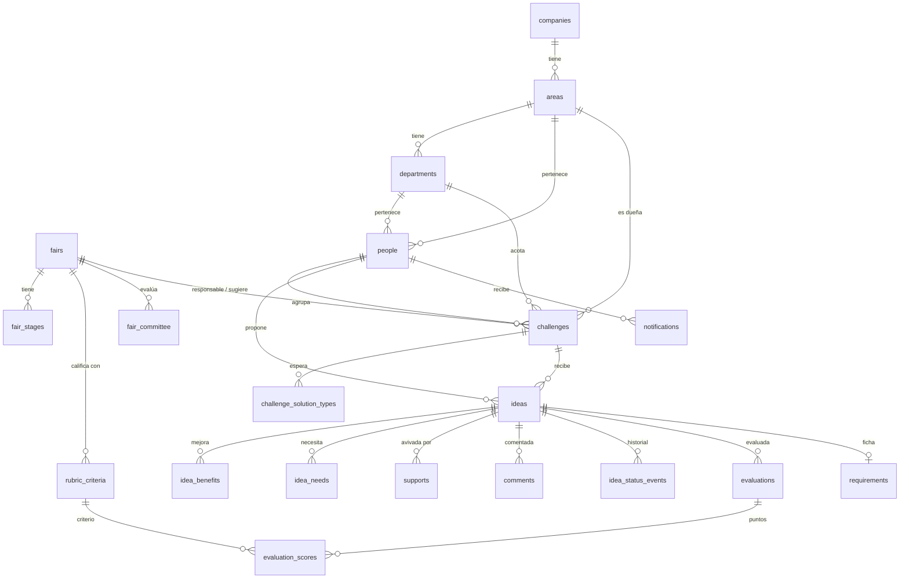

# Base de datos · Chispa

El esquema vive en `supabase/migrations/20261102000000_init.sql`; los catálogos y la feria 2026, en `supabase/seed.sql`; `supabase/seed_demo_org.sql` es una organización ficticia; la estructura real vive en una semilla local que no se publica. La prueba `supabase/tests/schema_check.mjs` levanta un Postgres en memoria (PGlite), aplica todo y comprueba 33 reglas: folios, contadores, permisos por rol, anonimato, historial y calificación.

```bash
cd supabase/tests && npm install --ignore-scripts && npm run check
```

## El mapa



## Las tablas y por qué

### Organización: igual que el sistema de RH

La estructura sigue la del sistema de RH de la empresa (**empresa → área → departamento → puesto → persona**), para que en la fase 2 se sincronice sin traducir conceptos. Chispa no necesita puestos: guarda el área y el departamento de cada persona.

| Tabla | Por qué así |
|---|---|
| `companies` | Una fila por empresa (razón social). `rh_key` guarda su clave en RH. |
| `areas` | Cada área pertenece a una empresa; el código es único **por empresa**, como en RH. Tiene un encargado (`manager_id`). |
| `departments` | Hijo del área. El mismo nombre de departamento existe en varias áreas, por eso no es un catálogo suelto. Tiene su propio encargado. |
| `people` | `employee_number` es **texto**, no número: los ceros a la izquierda importan (`00423`). `auth_subject` liga la persona con la sesión (hoy Supabase, mañana el `sub` de Auth0) sin cambiar ninguna otra tabla. `challenges_seen_at` alimenta el contador de retos nuevos. La llave compuesta `(department_id, area_id)` impide poner a alguien en un departamento que no es de su área. |
| `rh_key` | La clave del registro en RH, única y opcional. En la fase 2 la sincronización actualiza por esa llave sin duplicar. |

**El responsable es el encargado**, como en RH: uno por área y uno por departamento. El encargado del área maneja los retos de toda su área; el de un departamento, sólo los de su departamento (`can_manage(area, departamento)`).

**El rol no se guarda, se deduce.** Colaborador es cualquiera; responsable es quien es encargado de un área o departamento; comité es quien está en `fair_committee` de la feria vigente. El comité cambia cada edición sin tocar a las personas.

### Feria

| Tabla | Para qué | Por qué así |
|---|---|---|
| `fairs` | Cada edición (2026, 2027…). | Es lo que hace escalable el portal: los retos, folios, etapas, rúbrica y comité cuelgan de una edición. El año que entra se abre otra feria sin borrar la historia. Un índice único parcial garantiza **una sola feria vigente**. |
| `fair_stages` | Las 5 etapas con fechas. | En tabla y no en código: el comité mueve fechas sin desplegar. `check (ends_on >= starts_on)`. |
| `fair_committee` | Integrantes del comité por edición. | Muchos a muchos y por feria: el comité cambia cada año sin tocar a las personas. |
| `rubric_criteria` | Impacto, factibilidad, costo, alcance… | Configurable por feria y con `weight`: si el comité decide que el impacto pesa más (la semilla le da 1.5), se cambia un número, no el código. |

### Retos y chispas

| Tabla | Para qué | Por qué así |
|---|---|---|
| `challenges` | Los retos. | Pertenecen a un área y, si se quiere acotar, a uno de sus departamentos; la llave compuesta impide un departamento de otra área. Llave `uuid` para el sistema y `folio` entero para la gente (`RET-001`), único **por feria**. `status` con `check` en lugar de un `enum` de Postgres: se migra igual a SQL Server y se le agregan valores sin `ALTER TYPE`. `published_at` vacío mientras es sugerencia; el `check` impide un sugerido publicado. `idea_count` y `support_count` son contadores mantenidos por triggers. |
| `challenge_solution_types` | Tipos de solución que espera el reto. | Tabla puente en vez de arreglo: SQL Server no tiene arreglos, y se puede filtrar con índice. |
| `ideas` | Las chispas. | `fair_id` se copia del reto para que el folio `CHI-001` sea único por feria sin un join. `is_anonymous` es de **presentación**: `author_id` siempre se guarda porque el comité necesita contactar y el autor necesita ver sus avances. |
| `idea_benefits`, `idea_needs` | Qué mejora y qué se necesitaría. | Beneficios contra catálogo (para reportes: "¿cuántas chispas ahorran tiempo?"); necesidades como texto libre ordenado. |
| `idea_status_events` | Cada cambio de estado, con quién y cuándo. | Es la línea de avance de la pantalla, la auditoría y la fuente de notificaciones. Un trigger lo escribe solo; nadie puede saltárselo. |
| `solution_types`, `benefits` | Catálogos. | Llave natural (`software`, `time`): estable, legible en la semilla y en la URL (`?type=software`). |

### Participación y evaluación

| Tabla | Para qué | Por qué así |
|---|---|---|
| `supports` | Avivadas. | Llave compuesta `(idea_id, person_id)`: es **imposible** avivar dos veces, lo garantiza la base, no la pantalla. `created_at` permite medir tendencia por semana. |
| `comments` | Comentarios. | `parent_id` deja la puerta a respuestas en hilo. `deleted_at` en lugar de borrar: se puede moderar sin romper la conversación. |
| `evaluations` + `evaluation_scores` | Una evaluación por evaluador y chispa, con un puntaje por criterio. | `unique (idea_id, evaluator_id)`: cada quien califica una vez y puede corregir. Los puntajes en filas (no en columnas `impact`, `cost`…) para que la rúbrica pueda cambiar de criterios. `check (score between 1 and 5)`. |
| `requirements` | Ficha de requerimiento. | Se **guarda** en vez de generarse cada vez: el equipo de desarrollo la ajusta en el levantamiento y esos cambios no se pierden. `unique (idea_id)`: una ficha por chispa. Columnas y no JSON, por portabilidad y para poder buscar. |
| `notifications` | Avisos para la persona. | Hoy se llenan cuando cambia el estado de tu chispa. La pantalla de avisos queda lista para la fase 1. |
| `folio_counters` | El siguiente folio por feria y tipo. | `insert … on conflict do update … returning` bloquea la fila: dos personas enviando al mismo segundo no reciben el mismo folio. |

## Lo que hace la base sola (triggers)

- Asigna folio y fecha de publicación al crear un reto o una chispa.
- Fuerza el estado inicial `received` de una chispa y sus contadores en cero: el cliente no puede mandar una chispa "ya seleccionada" ni con 500 avivadas.
- Mantiene `idea_count`, `support_count` y `comment_count`. Las listas se ordenan por "más avivadas" o "en tendencia" sin contar miles de filas en cada consulta.
- Registra cada cambio de estado en `idea_status_events` y avisa al autor.
- Publica un reto sugerido en cuanto el área lo acepta.
- Actualiza `updated_at`.

## Lecturas preparadas (vistas)

| Vista | Para qué |
|---|---|
| `idea_cards` | Lo que el cliente lee de una chispa. Devuelve `author_id` vacío si es anónima, salvo para el autor y el comité, y `supported_by_me` para pintar el botón Avivar. La tabla `ideas` no expone `author_id` al cliente. |
| `challenge_activity_7d` | Avivadas y chispas de los últimos 7 días por reto: la base de "En tendencia". Con la ventana de tiempo, un reto viejo con muchas avivadas no se queda arriba para siempre. |
| `idea_scores` | Calificación ponderada (1 a 5) por chispa con todos sus evaluadores. |

## Seguridad: RLS

Supabase expone las tablas al navegador, así que las reglas viven en la base (Row Level Security). Las garantiza Postgres aunque alguien llame al API a mano:

- Todo se lee con sesión; nada con la llave anónima.
- Un reto **sugerido** sólo lo ven quien lo sugirió, los responsables del área y el comité.
- Sólo publica retos abiertos el encargado del área (o del departamento, para su departamento) o el comité. Un colaborador sólo puede sugerir.
- Sólo propones, avivas y comentas **a tu nombre**, y sólo en retos abiertos y vigentes.
- Sólo el encargado correspondiente o el comité cambian el estado de una chispa, evalúan y generan la ficha.
- Cada quien ve sólo sus notificaciones.

Funciones de apoyo: `current_person_id()`, `can_manage(area, departamento)`, `is_committee(feria)`.

## Login simulado (fase 1)

La web inicia una sesión **anónima** de Supabase y llama a `claim_employee_number('12345')`, que liga esa sesión con la persona. Con eso RLS funciona de verdad desde el primer día. Sigue siendo una cortina, porque quien sepa un número puede entrar como esa persona. Es aceptable para la demo, no para producción.

En fase 2 se cambia el proveedor: Auth0 como *third-party auth* de Supabase, o el API .NET validando el token de Auth0. `auth_subject` guarda el `sub` y ninguna tabla cambia.

## Paso a SQL Server (fase 2)

El esquema evita a propósito lo que sólo existe en Postgres, para que la migración sea mecánica:

| Postgres | SQL Server |
|---|---|
| `uuid` + `gen_random_uuid()` | `uniqueidentifier` + `NEWSEQUENTIALID()` |
| `timestamptz` | `datetimeoffset` |
| `text` + `check (length…)` | `nvarchar(n)` + `CHECK` |
| `check (status in (…))` | `CHECK` igual |
| Tablas puente en vez de arreglos | Igual |
| Triggers de contadores | Triggers T-SQL o handlers del API (MediatR) |
| RLS | Políticas en el API: `[Authorize]` y validadores, como en el proyecto de referencia |
| Vistas | Vistas o consultas de lectura en Application |

## Cómo escala

- **Muchas ediciones:** todo cuelga de `fairs`; los folios reinician por feria.
- **Muchas avivadas:** los contadores evitan `count(*)` en cada lista; hay índices para la lista de retos (`fair_id, status, published_at`), las chispas por reto (`challenge_id, support_count`) y la bandeja de avisos.
- **Rúbrica que cambia:** criterios y pesos son datos.
- **Más empresas, áreas o departamentos:** son filas, y `rh_key` permite sincronizarlas con RH.
- **Auditoría:** historial de estados y borrado lógico de comentarios.

Queda para después, sin cambiar lo que ya existe: adjuntos (Supabase Storage + `challenge_attachments` / `idea_attachments`), menciones y respuestas en hilo.
